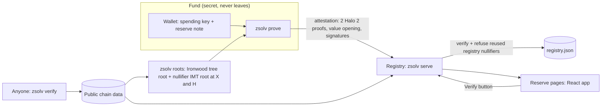

# Z-Solvency

**Show the money, not the people.** A fund that holds money for others proves it holds what it promised, and nobody learns who gave or who got.

A strike, legal-defence or mutual-aid fund keeps its reserve in Zcash's shielded Ironwood pool and publishes a proof each round: *at least T ZEC, held since block X, controlled by the fund, and counted by no other fund.* Anyone can check it against roots rebuilt from public chain data. Nothing else is revealed.


## Why

Funds that hold money for others run on trust, and trust usually means showing the books. For a protest fund, the books are a list of donors and recipients.

| Case | What happened | What it shows |
|---|---|---|
| 612 Humanitarian Relief Fund, Hong Kong | Paid medical and legal fees for 2019 protesters until Oct 2021. Trustee Cardinal Joseph Zen was arrested in May 2022, and six people were convicted of failing to register the fund. | Legal-defence funds become targets |
| Freedom Convoy donors, Canada | A 2022 GiveSendGo breach exposed 92,845 donors. | Donor lists leak |
| Feminist Coalition, Nigeria | During #EndSARS in Oct 2020 its donation bank account and Flutterwave link were cut. A year later critics demanded it account for the funds; its audited report went only to donors. | A fund gets cut off, then doubted |

A published viewing key would prove the balance, but it is permanent, exact, and shows every donation, memo and payout. Z-Solvency publishes one line instead.

## What the proof says

| Guarantee | How | What it stops |
|---|---|---|
| At least T ZEC | The delegation circuit commits to the notes' total value in 0.125 ZEC steps (`van_comm`), and the fund opens that commitment. Over-claiming is impossible in-circuit. | Revealing the real balance |
| Controlled by the fund | A RedPallas spend-auth signature under each proof's `rk` over the round message (fund, round, block H's hash, T, registry nullifiers). | Proving with someone else's viewing key; replaying an old proof |
| Published by that fund | Registering a fund id binds the fund's own key. That key signs every profile change (with a rising sequence number) and every round message, and the registry refuses anything else without touching the fund's page. | Editing another fund's name or obligations; publishing a round under another fund with your own coins |
| One note, one fund | Each note shows an alternate nullifier scoped to the registry (`vote_round_id` = registry id), not its real nullifier. The registry refuses one that another fund already counted. | Two funds counting the same coins |
| Held since block X | Two proofs, at X and at H, over the same notes: all five registry nullifiers must match. A spent note can't come back. | Borrowing coins for audit day |

Anyone sees T, heights X and H, the registry nullifiers, the message and the proofs. Nobody sees the balance, which notes, addresses, history, memos, donors, recipients, or the notes' real nullifiers.

**Solvency, not just reserves.** The fund publishes its obligations (e.g. 120 workers × 1 ZEC/week × 4 weeks = 480 ZEC) and sets T to cover them. The page compares the two.

**Why a reserve note of exactly T.** The circuit commits to `floor(total / 0.125 ZEC)`, so opening it reveals the total to within 0.125 ZEC. A reserve note of exactly T reveals only T, with no new cryptography. `zsolv prove` refuses if the reserve would reveal more. A range proof for a hidden total is on the roadmap.

**What it doesn't prove:** where the coins came from; that the fund keeps them after the proof (each round proves it again); that the published obligations are complete; that a friend didn't lend the fund coins for months.

## How it works



- **Prover** (`src/attest.rs`): for heights X and H it rebuilds the Ironwood note commitment tree (`src/tree.rs`) and the nullifier IMT (`src/imt.rs`), builds a Valar delegation proof over the reserve notes, reusing the same padding notes in both, and signs the round message with each proof's randomized key.
- **Verifier** (`zsolv verify`, and the registry): rebuilds both roots from chain data and never trusts copies in the attestation. It checks both proofs, the value opening against T, both signatures, the block hash at H, that all five registry nullifiers match between X and H, and that they are distinct within each proof.
- **Registry** (`src/registry.rs`): binds each fund id to the key that registered it, accepts profile changes and rounds only under that key, verifies each submission, refuses a registry nullifier already owned by another fund, refuses a round that isn't newer, and serves the JSON API plus the web app.
- **Web** (`web/`): React + TypeScript (Vite). Shows the status light, held-since, last check, obligations, a live Verify button, and the viewing-key contrast panel.

## Run it

Needs Rust ≥ 1.97 and Node ≥ 22.

```bash
scripts/demo.sh
```

That builds everything, creates a local Ironwood devnet, and plays out the demo:
- **Mill Workers' Strike Fund** passes: at least 480 ZEC, held since block X.
- **Quick Relief Fund** borrows 480 ZEC the block before the check. It can't prove "held since X", and relabelling the height fails verification. Its honest proof says "held since H−1", so it shows amber.
- **Shadow Solidarity Fund** submits the same note and is refused.

Then open http://127.0.0.1:8080.

Tests (the Tuesday gate plus the cheats, with real proofs, about 12 s):

```bash
cargo test --release
```

Frontend development with hot reload, proxying `/api` to a running registry:

```bash
npm --prefix web run dev
```

### CLI

```
zsolv devnet init | mine --blocks N | status
zsolv wallet new <name> | show <name>
zsolv send --to <wallet> --amount <ZEC> [--from <wallet>] [--label ...] [--memo ...] [--reserve]
zsolv reserve --wallet <w> --amount <ZEC>        # one reserve note of exactly T
zsolv roots [--height N]                          # rebuild roots from chain data
zsolv prove --wallet <w> --fund-id <id> --threshold <ZEC> [--since X] [--at H] [--round N] [--fund-key file] [--out file]
zsolv verify <attestation.json>
zsolv fund --id <id> --name <name> --obligation "label=ZEC" [--min-held-blocks N] [--max-proof-age-blocks N] [--url URL] [--fund-key file]
                                                  # first run creates <data>/funds/<id>.key.json (secret)
zsolv submit <attestation.json> [--url URL]
zsolv serve [--addr 127.0.0.1:8080] [--web web/dist]
```

### API

| Method | Path | |
|---|---|---|
| GET | `/api/state` | Registry, chain tip, funds with status, event log |
| GET | `/api/funds/:id` | One fund's page data |
| GET | `/api/funds/:id/attestation` | Latest attestation (raw, for `zsolv verify`) |
| POST | `/api/funds/:id/verify` | Re-verify the latest attestation now |
| POST | `/api/funds` | Register or update a fund profile, signed by the fund key |
| POST | `/api/attest` | Submit an attestation, signed by the fund key |
| GET | `/api/roots/:height` | Tree and nullifier-IMT roots at a height |

## Built on

- [`voting-circuits`](https://docs.rs/crate/voting-circuits/0.14.0) 0.14 (Valar, MIT or Apache-2.0): the delegation proof (Halo 2, K=12) behind coinholder polls. It proves up to 5 Ironwood notes are in the tree, unspent (IMT non-membership), with domain-separated alternate nullifiers and a value commitment. Z-Solvency uses it unmodified, so there's no new circuit to trust.
- `voting-crypto-deps` / `zakura-orchard` 4.0 (MIT or Apache-2.0): the Orchard-protocol implementation with Ironwood (V3) notes that the circuits are built on.
- Not used: [ZAIR](https://github.com/eigerco/zair). It includes the June 2026 Orchard fix (commit `568922c`), but it is pinned to orchard 0.11 and has no Ironwood support.

Written for Z-Solvency:
- the attestation format and round message
- the two-snapshot held-since check
- the registry-nullifier rules (all five match, distinct within a proof, owned by one fund)
- full-size nullifier IMT and tree rebuilding
- the verifier, registry, CLI, devnet and web app

Pre-hack work (allowed by WebZero): this repository as of 1 Nov 2026. Work done on 4 Nov is listed in the commit history.

## Limits

- **Devnet, not testnet yet.** Chain data comes from a local Ironwood devnet (`data/chain/ledger.json`), and wallets record received notes directly instead of trial-decrypting. Testnet needs an Ironwood-capable lightwalletd and scanner to feed `zsolv roots` and the wallet; the proof and verify path stays the same.
- The circuits are used outside the voting protocol they were designed and reviewed for. Check their audit status before mainnet.
- At most 5 reserve notes per proof (one reserve note of exactly T is the intended use).
- The registry nullifier links one fund's own rounds, by design. T, the heights and the timing are public.
- Fund ids are first come, first served: whoever registers an id first binds its key. There is no key rotation or recovery yet; a lost fund key means registering a new id.
- The registry is a single process with a JSON file. The Verify button runs on the registry; independent checks use `zsolv verify`.

## Roadmap

1. Testnet: Ironwood scanning, real roots, real notes.
2. Range proof for "at least T" with a hidden total.
3. Member-checkable liabilities: a Merkle-sum tree of balances each member can check, with T set to its total.
4. Verification in the browser (WASM), then mainnet.
