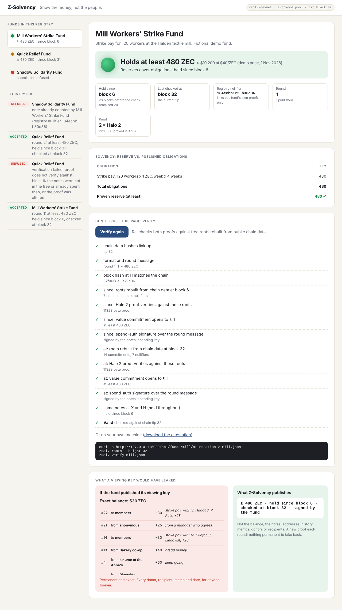
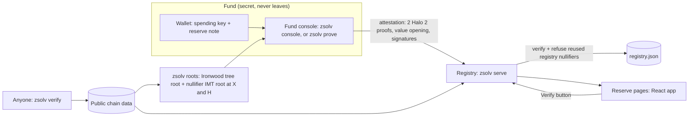

# Z-Solvency

**Show the money, not the people.** A fund that holds money for others proves it holds what it promised, and nobody learns who gave or who got.

A strike, legal-defence or mutual-aid fund keeps its reserve in Zcash's shielded Ironwood pool and publishes a proof each round: *at least T ZEC, held since block X, controlled by the fund, and counted by no other fund.* Anyone can check it against roots rebuilt from public chain data. Nothing else is revealed.



## Why

Funds that hold money for others run on trust, and trust usually means showing the books. For a protest fund, the books are a list of donors and recipients.

| Case | What happened | What it shows |
|---|---|---|
| 612 Humanitarian Relief Fund, Hong Kong | Paid medical and legal fees for 2019 protesters until Oct 2021. Trustee Cardinal Joseph Zen was arrested in May 2022, and six people were convicted of failing to register the fund. | Legal-defence funds become targets |
| Freedom Convoy donors, Canada | A 2022 GiveSendGo breach exposed 92,845 donors. | Donor lists leak |
| Feminist Coalition, Nigeria | During #EndSARS in Oct 2020 its donation bank account and Flutterwave link were cut. A year later critics demanded it account for the funds; its audited report went only to donors. | A fund gets cut off, then doubted |

A published viewing key would prove the balance, but it is permanent, exact, and shows every donation, memo and payout. Z-Solvency publishes one line instead.

## What the proof says

| Guarantee | How | What it stops |
|---|---|---|
| At least T ZEC | The delegation circuit commits to the notes' total value in 0.125 ZEC steps (`van_comm`), and the fund opens that commitment. Over-claiming is impossible in-circuit. | Revealing the real balance |
| Controlled by the fund | A RedPallas spend-auth signature under each proof's `rk` over the round message (fund, round, block H's hash, T, registry nullifiers). | Proving with someone else's viewing key; replaying an old proof |
| Published by that fund | Registering a fund id binds the fund's own key, derived from its wallet, so the wallet's backup words restore it. That key signs every profile change (with a rising sequence number) and every round message, and the registry refuses anything else without touching the fund's page. | Editing another fund's name or obligations; publishing a round under another fund with your own coins |
| One note, one fund | Each note shows an alternate nullifier scoped to the registry (`vote_round_id` = registry id), not its real nullifier. The registry refuses one that another fund already counted. | Two funds counting the same coins |
| Held since block X | Two proofs, at X and at H, over the same notes: all five registry nullifiers must match. A spent note can't come back. | Borrowing coins for audit day |

Anyone sees T, heights X and H, the registry nullifiers, the message and the proofs. Nobody sees the balance, which notes, addresses, history, memos, donors, recipients, or the notes' real nullifiers.

**Solvency, not just reserves.** The fund publishes its obligations (e.g. 120 workers × 1 ZEC/week × 4 weeks = 480 ZEC) and sets T to cover them. The page compares the two.

**Why a reserve note of exactly T.** The circuit commits to `floor(total / 0.125 ZEC)`, so opening it reveals the total to within 0.125 ZEC. A reserve note of exactly T reveals only T, with no new cryptography. `zsolv prove` refuses if the reserve would reveal more. A range proof for a hidden total is on the roadmap.

**What it doesn't prove:** where the coins came from; that the fund keeps them after the proof (each round proves it again); that the published obligations are complete; that a friend didn't lend the fund coins for months.

## How it works



- **Prover** (`src/attest.rs`): for heights X and H it rebuilds the Ironwood note commitment tree (`src/tree.rs`) and the nullifier IMT (`src/imt.rs`), builds a Valar delegation proof over the reserve notes, reusing the same padding notes in both, and signs the round message with each proof's randomized key.
- **Verifier** (`zsolv verify`, and the registry): rebuilds both roots from chain data and never trusts copies in the attestation. It checks both proofs, the value opening against T, both signatures, the block hash at H, that all five registry nullifiers match between X and H, and that they are distinct within each proof.
- **Registry** (`src/registry.rs`): binds each fund id to the key that registered it, accepts profile changes and rounds only under that key, verifies each submission, refuses a registry nullifier already owned by another fund, refuses a round that isn't newer, and serves the JSON API plus the web app. Funds are unlisted: nothing enumerates them. Each fund gets a random 128-bit link token at first registration, returned only to whoever signs as the fund, and its page, attestation and Verify are reachable only through that link. A refusal for a reused note says "another fund", not which one.
- **Fund console** (`src/console.rs`): `zsolv console` serves the treasurer's app on 127.0.0.1: set up the wallet (24 backup words), register the fund, lock the reserve, prove and publish with each step and its timing, and the history of rounds. It holds the keys; its API answers only its own page (a per-run token in the link, plus Host and Origin checks). A round the registry can't take is saved and retried.
- **Web** (`web/`): React + TypeScript (Vite). One app: on the registry, the landing page, "Create your link" (how to run the console), "Verify a link" (paste one), and the fund behind a link (status, facts, past rounds, obligations, a live Verify button, the viewing-key contrast); served by `zsolv console`, the fund console, which ends each round on the fund's share link.

The light, first match wins: red when the only submission was refused; grey before any proof; red when the latest proof no longer verifies (block H changed in a reorg); red after two missed cadences; amber when the proof is late by more than a seventh of the cadence (a day, for a weekly fund); amber when T is below the obligations; amber until the reserve has been held for the promised time; otherwise green.

## Run it

Needs Rust ≥ 1.97 and Node ≥ 22. `rust-toolchain.toml` makes cargo use your stable toolchain inside the repo, whatever your default is; if stable is older than 1.97, run `rustup update stable`.

```bash
scripts/demo.sh
```

That builds everything, creates a local Ironwood devnet, and plays out the demo:
- **Mill Workers' Strike Fund** passes: at least 480 ZEC, held since block X.
- **Quick Relief Fund** borrows 480 ZEC the block before the check. It can't prove "held since X", and relabelling the height fails verification. Its honest proof says "held since H−1", so it shows amber.
- **Shadow Solidarity Fund** submits the same note and is refused.

Then open http://127.0.0.1:8080. Funds aren't listed: the script prints each fund's share link at the end.

The treasurer's side: `./target/release/zsolv console` opens the fund console. Choose "Open a wallet already here", then `mill`, and press Prove and publish to publish Mill's next round.

Tests (the Tuesday gate plus the cheats, registry rules, the testnet path and malformed input, with real proofs, about 10 s):

```bash
cargo test --release
```

Frontend development with hot reload, proxying `/api` to a running registry:

```bash
npm --prefix web run dev
```

### On Zcash testnet

Chain data comes from a lightwalletd server (default `https://testnet.zec.rocks:443`) into `data-testnet/chain/ledger.bin`: every Ironwood action since activation at block 4,134,000. Each block must extend the last one, and its Ironwood tree size must match what the server reports.

```bash
export ZSOLV_DATA=data-testnet
zsolv testnet sync                       # about 6 minutes the first time; then incremental
zsolv roots --check                      # rebuilt Ironwood root vs. the node's own tree state
```

On 2 Nov 2026 the rebuilt root matched Zebra's at block 4,570,881 (798,245 commitments).

The fund keeps using an everyday Ironwood wallet (Zkool, Zingo) to receive and pay: Orchard receivers receive into Ironwood after NU6.3. Z-Solvency derives the same key from the seed phrase (ZIP 32, testnet coin type) and finds the notes by trial decryption:

```bash
ZSOLV_MNEMONIC="..." zsolv wallet import mill
zsolv wallet scan mill                   # about a minute over the whole testnet pool
zsolv reserve --wallet mill --amount 480 # marks the note of exactly 480 TAZ the wallet sent itself
```

`scripts/testnet-demo.sh` runs the whole demo on testnet from there and saves a snapshot of the public data, so the page can be replayed without testnet.

### Deploy

`Dockerfile` builds the registry and web app. `compose.yaml` runs it with a sync loop and Caddy (`Caddyfile`) for HTTPS on any VPS with ports 80 and 443 open:

```bash
DOMAIN=reserves.example.org docker compose up -d --build
```

The first sync takes about 6 minutes; until then the API answers "no chain data".

By default anyone may register an unused fund id. Funds aren't listed, but anyone can still create one. To accept only your own funds, close registration (`zsolv fund` and the console print each fund's public key):

```bash
docker compose exec registry zsolv registry allow --id mill --key <public key>
```

Load limits:
- POSTs (submissions, Verify, profile updates) are limited per client (`--rate-limit`, default 10 a minute). They run one at a time on a worker, so pages keep loading during a proof check.
- Root rebuilds at new heights, 10 to 20 s each on testnet, are limited across all clients (`--rebuilds-per-hour`, default 12).
- Keep the registry behind the proxy: Caddy reads each request whole before passing it on.

### Auditors and regulators

A company can hand its auditor or regulator a signed certificate for a round, without showing its books.

- **The registry certifies every round it accepts**, under its own key (`registry_key` in `/api/state`).
- **Approved authorities certify on request.** An auditor, regulator or compliance body creates a key (`zsolv authority new`, or `zsolv console --authority`), and the registry operator approves it (`zsolv registry approve-authority`). A company asks it to certify a published round from the console's Compliance tab. The authority re-verifies the proof on its own machine against its own chain data, then signs a certificate or declines with a reason.
- **Certificates are private to the company.** They never appear on the link page; the company reads them with a request signed by its fund key, and downloads them or saves them as a PDF.
- **Anyone can check one:** `zsolv certificate verify cert.json --url <registry>` checks the signature, that no field changed, and that the issuer is that registry or one of its approved authorities.

A certificate says that the round's proof verified. Like the proof, it reveals no balance, notes, addresses or history.

### CLI

```
zsolv devnet init | mine --blocks N | status
zsolv testnet info | sync [--server URL] [--to H] [--rewind N]
zsolv wallet new <name> | show <name> | import <name> [--account N] [--birthday H] | scan <name>
zsolv send --to <wallet> --amount <ZEC> [--from <wallet>] [--label ...] [--memo ...] [--reserve]
zsolv reserve --wallet <w> --amount <ZEC> [--cmx prefix]  # devnet: make it; testnet: mark it
zsolv roots [--height N] [--check]                # rebuild roots; --check against the node
zsolv prove --wallet <w> --fund-id <id> --threshold <ZEC> [--since X] [--at H] [--round N] [--out file]
zsolv verify <attestation.json>
zsolv fund --wallet <w> --id <id> --name <name> --obligation "label=ZEC" [--min-held-blocks N] [--max-proof-age-blocks N] [--url URL]
                                                  # signed with the fund key derived from the wallet
zsolv console [--addr 127.0.0.1:7070] [--no-open]  # the fund console, on this machine only
zsolv submit <attestation.json> [--url URL]
zsolv serve [--addr 127.0.0.1:8080] [--web web/dist] [--rate-limit N] [--rebuilds-per-hour N] [--trust-proxy]
zsolv registry allow --id <id> --key <public key> | open   # close registration
zsolv registry approve-authority --key <public key> --name <name> --role auditor|regulator|compliance
zsolv registry revoke-authority --key <public key> | authorities
zsolv authority new --name <name> --role auditor [--url URL] | show
zsolv certificate verify <certificate.json> [--url URL]
zsolv console --authority                           # the auditor's or regulator's console to listed funds, or reopen it
```

### API

| Method | Path | |
|---|---|---|
| GET | `/api/mode` | `registry` here; `console` from `zsolv console` |
| GET | `/api/state` | Registry id, network, chain tip. No funds: they are unlisted |
| GET | `/api/links/:link` | The fund behind a share link: status and past rounds |
| GET | `/api/links/:link/attestation` | Latest attestation (raw, for `zsolv verify`) |
| POST | `/api/links/:link/verify` | Re-verify the latest attestation now |
| POST | `/api/funds` | Register or update a fund profile, signed by the fund key; returns the fund's `link` |
| POST | `/api/attest` | Submit an attestation, signed by the fund key |
| GET | `/api/authorities` | Approved auditors, regulators and compliance bodies |
| POST | `/api/certificates/request` | A fund asks an authority to certify a round, signed by the fund key |
| POST | `/api/certificates/fund` | A fund's certificates and requests, signed by the fund key |
| POST | `/api/certificates/inbox` | An authority's requests, signed by its key |
| POST | `/api/certificates/issue` | An authority's signed certificate for a pending request |
| POST | `/api/certificates/decline` | An authority declines a request, with a reason |
| GET | `/api/roots/:height` | Tree and nullifier-IMT roots at a height this registry has computed |

## Built on

- [`voting-circuits`](https://docs.rs/crate/voting-circuits/0.14.0) 0.14 (Valar, MIT or Apache-2.0): the delegation proof (Halo 2, K=12) behind coinholder polls. It proves up to 5 Ironwood notes are in the tree, unspent (IMT non-membership), with domain-separated alternate nullifiers and a value commitment. Z-Solvency uses it unmodified, so there's no new circuit to trust.
- `voting-crypto-deps` / `zakura-orchard` 4.0 (MIT or Apache-2.0): the Orchard-protocol implementation with Ironwood (V3) notes that the circuits are built on.
- Not used: [ZAIR](https://github.com/eigerco/zair). It includes the June 2026 Orchard fix (commit `568922c`), but it is pinned to orchard 0.11 and has no Ironwood support.

Written for Z-Solvency:
- the attestation format and round message
- the two-snapshot held-since check
- the registry-nullifier rules (all five match, distinct within a proof, owned by one fund)
- full-size nullifier IMT and tree rebuilding
- the verifier, registry, CLI, devnet and web app

Pre-hack work (allowed by WebZero): this repository as of 1 Nov 2026. Work done on 4 Nov is listed in the commit history.

## Limits

- **Testnet chain data is trusted from one lightwalletd server.** The registry checks that blocks link up and that tree sizes match, and it rebuilds the roots itself, but it doesn't check proof of work. `zsolv roots --check` compares against that node's own tree state, not an independent one.
- The scan uses compact ciphertexts, so memos aren't read. The fund's everyday wallet has them.
- The circuits are used outside the voting protocol they were designed and reviewed for. Check their audit status before mainnet.
- At most 5 reserve notes per proof (one reserve note of exactly T is the intended use).
- The registry nullifier links one fund's own rounds, by design. T, the heights and the timing are public.
- By default X is the block where the reserve note was created. On a quiet chain that block points at the fund's own transaction. Pass a later `--since` to avoid that.
- Fund ids are first come, first served unless the operator closes registration: whoever registers an id first binds its key.
- The fund key is derived from the wallet's spending key: the backup words restore it, and anyone holding the spending key can speak for the fund. There is no key rotation yet; a fund that moves to a new wallet registers a new id.
- On testnet the console doesn't send transactions: the fund's everyday wallet sends the reserve note to itself, and the console finds it.
- The registry is a single process with a JSON file. The Verify button runs on the registry; independent checks use `zsolv verify`.

## Roadmap

1. A testnet fund holding real notes (the chain data and scanning are done).
2. Range proof for "at least T" with a hidden total.
3. Member-checkable liabilities: a Merkle-sum tree of balances each member can check, with T set to its total.
4. Verification in the browser (WASM), then mainnet.
